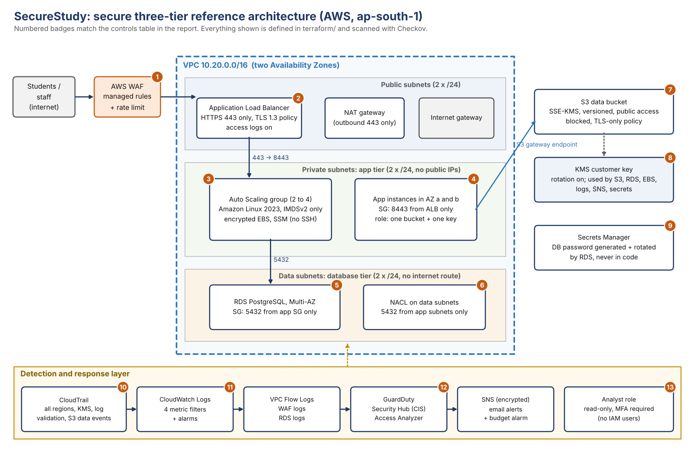

# SecureStudy: secure three-tier cloud architecture (capstone)

A student-records web platform designed, written as Terraform, and security-tested end to end:
architecture, IAM, network security, data protection, monitoring, assessment, and report.

**Constraint, stated up front:** no live cloud account was available (AWS, GCP and Azure signups
stalled on payment verification). This stack has **never been applied**. What was done for real:

| What | Status |
|---|---|
| Terraform (12 files, 110 resources) | written, parses as HCL, read by Checkov with 0 parsing errors |
| Checkov 3.3.27 scan | **real output**: 403 passed, 0 failed, 16 skipped (each with a written reason) |
| Red-team test of the scanner | **real**: 16 defects injected, 14 caught by built-in rules, 2 more by custom policies |
| detect-secrets 1.5.0 | **real**: 0 files flagged |
| `detection/detect.py` | my script run on **synthetic** CloudTrail events (not real telemetry) |
| `terraform validate / plan / apply` | **not run** (Terraform binary could not be downloaded) |



## Layout

```
terraform/     network, security groups, IAM, WAF, ALB + ASG, RDS, S3, KMS, CloudTrail, alarms, GuardDuty
policies/      two custom Checkov policies (world-open ports other than 443; unencrypted launch-template volumes)
red-team/      injects 16 known defects into a copy of terraform/ and reports which the scanner catches
detection/     synthetic CloudTrail generator + rule-based detector (Capital One style attack timeline)
scans/         raw tool output
docs/          architecture diagram (+ the script that draws it)
.github/       CI: scan, red-team test, secrets scan, detector self-test (written, not yet run on GitHub)
```

## Reproduce

```bash
pip install checkov==3.3.27 detect-secrets==1.5.0

checkov -d terraform --framework terraform --compact                          # 0 failed, 16 skipped
checkov -d terraform --framework terraform --external-checks-dir policies --compact
python3 red-team/mutate_and_scan.py                                           # caught 16 of 16
detect-secrets scan --all-files --exclude-files '^scans/'                     # 0 files flagged
cd detection && python3 generate_sample_logs.py && python3 detect.py sample_cloudtrail.json   # 7 findings
```

## Deploying it (not free tier)

Needs your own ACM certificate (`certificate_arn`), an admin IP, and an alert email: see
`terraform/terraform.tfvars.example`. NAT gateway, ALB, Multi-AZ RDS, GuardDuty and WAF all cost
money; this is not a free-tier stack. Run `terraform validate` and `plan` first: the RDS engine
version and the Security Hub standard version are the most likely things to need a small edit.

## Limits

- Static analysis reads code, not a running account. Nothing here has been deployed.
- The two custom policies were written after seeing which injected defects Checkov missed, so the
  16/16 result shows the gaps are closed for those defects, not that no gaps remain.
- Detector thresholds were tuned on the same synthetic data they are tested on.
